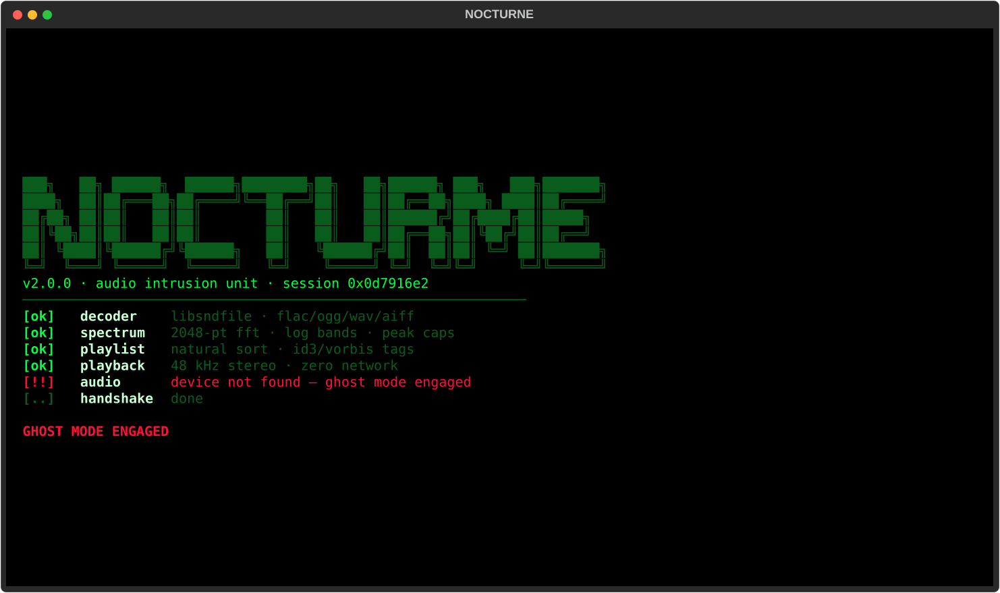

<div align="center">

# ▓▒░ NOCTURNE

**The hacker's terminal music player — Mr. Robot vibes, live spectrum, zero network.**

I am a terminal music player. Feed me a folder. I play everything inside it.
**100% offline. No accounts. No telemetry. No packets leave this machine.**
[فارسی](README.fa.md) | [English](README.md) 
[](.github/workflows/ci.yml)
[](https://www.python.org/)
[](LICENSE)
[](#why-offline)

**Boot sequence** — every launch feels like intrusion day:



**The player** — fsociety theme, live FFT spectrum, waveform seek bar,
`root@nocturne` prompt:


</div>

## ✨ Features

- 👾 **Hacker boot sequence** — typed-out system log with `ACCESS GRANTED` (skip with any key, disable with `--no-boot`)
- 📊 **3 live visualizers** (`v` to cycle):
  - **spectrum** — real-time FFT, log-spaced bands, falling peak caps, auto-gain
  - **matrix rain** — digital rain that dances to the music
  - **oscilloscope** — raw waveform trace
- 〰️ **Waveform seek bar** — rendered from the actual track envelope; click or drag to seek
- 📂 **Folder = playlist** — recursive scan, natural sort (`track2` < `track10`), ID3/Vorbis tags
- 🎵 **Plays (almost) everything** — `FLAC`, `WAV`, `OGG/Opus`, `AIFF`, `MP3` (always, via bundled miniaudio), and `M4A/AAC/WMA` when ffmpeg is on PATH
- 🩺 **Honest scanning** — files it can't decode are counted and reported, never silently dropped
- 🔀 **Shuffle & repeat** (off / all / one) with auto-advance and auto-skip of dead files
- 🎨 **5 CRT-grade themes** — `fsociety`, `redroom`, `crt`, `cipher`, `ghost`
- 🧘 **Zen mode** (`f`) — giant visualizer, nothing else
- 🔍 **Instant filter** (`/`) — by title / artist / filename
- 💾 **M3U export** (`ctrl+s`), persistent config (folder / volume / theme / modes)
- 👻 **Ghost mode** (`--silent`) — full UI with no audio device (SSH boxes, CI, demos)

## 🚀 Quick start

```bash
git clone https://github.com/YOUR_USERNAME/nocturne.git
cd nocturne
pip install .

# zero downloads needed — synthesize demo tracks and play them:
python scripts/make_demo_tracks.py
nocturne demo_tracks
```

Point it at your library:

```bash
nocturne ~/Music                 # recursive scan, autoplay
nocturne ~/Music --flat          # ignore subfolders
nocturne ~/Music -s -r one       # shuffle + repeat-one
nocturne song.flac               # a single file
nocturne --theme redroom         # pick a theme
nocturne --no-boot --list-themes # skip intro, list themes
```

With no arguments, Nocturne reopens your last target folder.

### Linux note

`sounddevice` needs PortAudio:

```bash
sudo apt install libportaudio2        # Debian/Ubuntu
sudo dnf install portaudio            # Fedora
sudo pacman -S portaudio              # Arch
```

On **Windows** and **macOS** the wheels bundle everything — just `pip install .`
(use [Windows Terminal](https://aka.ms/terminal) on Windows for the full CRT look).

## ⌨️ Key bindings

| Key | Action |
|---|---|
| `space` | play / pause |
| `n` / `p` | next / previous track |
| `←` `→` | seek −5s / +5s |
| `,` `.` | seek −30s / +30s |
| `+` / `−` | volume up / down |
| `m` | mute |
| `v` | visualizer: spectrum → matrix rain → oscilloscope |
| `s` | shuffle |
| `r` | repeat: off → all → one |
| `t` | next theme |
| `f` | zen mode |
| `/` | filter playlist (`esc` clears) |
| `enter` / click | play track |
| click / drag waveform | seek |
| `o` | open folder or file |
| `F5` | rescan |
| `ctrl+s` | save playlist as `.m3u` |
| `?` | help (`nocturne(1)` man-style) |
| any key | skip boot sequence |
| `q` | quit — "control is an illusion" |

## 🎨 Themes

`fsociety` (phosphor green) · `redroom` (alarm red) · `crt` (amber terminal) ·
`cipher` (ice cyan) · `ghost` (violet) — cycle with `t`, start with
`--theme matrix`… sorry, `--theme redroom`. Your pick is saved.

## ⚙️ Configuration

One tiny JSON file (folder, volume, theme, shuffle, repeat, visualizer mode):

- Linux/macOS: `~/.config/nocturne/config.json`
- Windows: `%APPDATA%\nocturne\config.json`

## 🗂 Project layout

```
nocturne/
├── nocturne/
│   ├── app.py        # Textual UI: screens, bindings, playlist logic
│   ├── boot.py       # typed-out boot sequence overlay
│   ├── cli.py        # argparse front-end
│   ├── engine.py     # sounddevice stream + silent "ghost" fallback
│   ├── scanner.py    # recursive scan, natural sort
│   ├── metadata.py   # mutagen tags, Track model
│   ├── spectrum.py   # FFT analyzer (log bands, peaks, auto-gain)
│   ├── widgets.py    # spectrum / rain / scope + waveform widgets
│   ├── themes.py     # 5 themes + gradient helpers
│   └── config.py     # JSON persistence
├── scripts/
│   ├── make_demo_tracks.py   # synthesizes demo music with numpy
│   └── smoke_run.py          # headless screenshot runner
├── tests/            # 37 tests (engine, scanner, DSP, UI pilot)
└── pyproject.toml
```

## 🧪 Development

```bash
pip install -e ".[dev]"
pytest
```

## Why offline?

Nocturne scans the folders you give it, decodes audio in-process with libsndfile
and plays it through your sound device. There is **no network code at all** —
nothing phones home, nothing to subpoena. Your machine stays yours.

> Your traffic is monitored. Keep it that way — locally.

## License

[MIT](LICENSE) — do whatever you want, just keep the notice.
