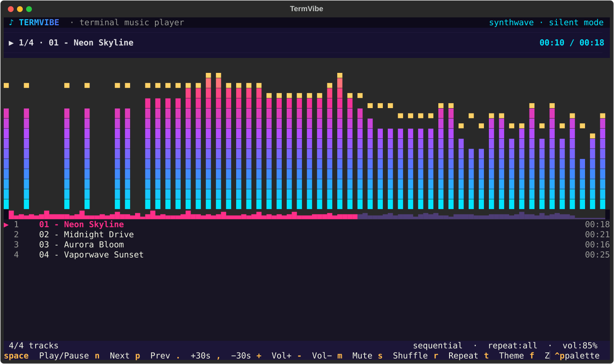

<div align="center">

# ♪ TermVibe

**A stunning terminal music player — live spectrum, waveform seeking, neon themes. 100% offline.**

[](.github/workflows/ci.yml)
[](https://www.python.org/)
[](LICENSE)
[](README.md#why-offline)



</div>

Point TermVibe at any folder and it finds every audio file inside (recursively),
builds a playlist and plays it — with a real-time FFT spectrum analyzer, a
clickable waveform seek bar, shuffle/repeat, a live playlist filter and five
neon color themes. **No accounts, no streaming, no telemetry — your music never
leaves your machine.**

## ✨ Features

- 🎵 **Plays everything libsndfile does** — `FLAC`, `WAV`, `OGG/Opus`, `AIFF`, …
- 📊 **Live spectrum visualizer** — real FFT (log-spaced bands), fast-attack/slow-release smoothing, falling peak caps, auto-gain
- 〰️ **Waveform seek bar** — rendered from the actual track envelope; click or drag to seek
- 📂 **Folder = playlist** — recursive scan with natural sorting (`track2` before `track10`), reads ID3/Vorbis tags (title/artist/album/bitrate/year)
- 🔀 **Shuffle & repeat** (off / all / one) with gap-free-ish auto advance
- 🎨 **5 neon themes** — `synthwave`, `matrix`, `sunset`, `ice`, `candy` — press `t` to cycle
- 🧘 **Zen mode** — giant visualizer, everything else hidden
- 🔍 **Instant filter** — press `/` and type to filter by title/artist/filename
- 💾 **M3U export** (`ctrl+s`), remembers your last folder, volume & theme
- 🔇 **Silent mode** (`--silent`) — full UI without an audio device (demos, CI,SSH boxes)

## 🚀 Quick start

```bash
git clone https://github.com/YOUR_USERNAME/termvibe.git
cd termvibe
pip install .

# try it instantly with generated demo tracks (no downloads needed):
python scripts/make_demo_tracks.py
termvibe demo_tracks
```

Or just point it at your library:

```bash
termvibe ~/Music                 # recursive scan, autoplay
termvibe ~/Music --flat          # ignore subfolders
termvibe ~/Music -s -r one       # shuffle + repeat-one
termvibe song.flac               # a single file
termvibe --theme matrix          # pick a theme
termvibe --list-themes
```

With no arguments, TermVibe reopens your last folder.

### Linux note

`sounddevice` needs PortAudio:

```bash
sudo apt install libportaudio2        # Debian/Ubuntu
sudo dnf install portaudio            # Fedora
sudo pacman -S portaudio              # Arch
```

On **Windows** and **macOS** the wheels bundle everything — just `pip install .`
(use [Windows Terminal](https://aka.ms/terminal) for the best look on Windows).

## ⌨️ Key bindings

| Key | Action |
|---|---|
| `space` | play / pause |
| `n` / `p` | next / previous track |
| `←` `→` | seek −5s / +5s |
| `,` `.` | seek −30s / +30s |
| `+` / `−` | volume up / down |
| `m` | mute |
| `s` | shuffle |
| `r` | repeat mode: off → all → one |
| `t` | next color theme |
| `f` | zen mode (giant visualizer) |
| `/` | filter playlist (`esc` clears) |
| `enter` / click | play highlighted track |
| click / drag waveform | seek |
| `o` | open folder or file |
| `F5` | rescan folder |
| `ctrl+s` | save playlist as `.m3u` |
| `?` | help overlay |
| `q` | quit |

## 🎨 Themes

`synthwave` · `matrix` · `sunset` · `ice` · `candy` — cycle with `t`, or start
with `--theme matrix`. Your choice is saved to the config file.

## ⚙️ Configuration

TermVibe stores a tiny JSON file (folder, volume, theme, shuffle, repeat):

- Linux/macOS: `~/.config/termvibe/config.json`
- Windows: `%APPDATA%\termvibe\config.json`

## 🗂 Project layout

```
termvibe/
├── termvibe/
│   ├── app.py        # Textual UI (screens, bindings, playlist logic)
│   ├── cli.py        # argparse front-end
│   ├── engine.py     # sounddevice stream + silent-clock fallback
│   ├── scanner.py    # recursive folder scan, natural sort
│   ├── metadata.py   # mutagen tags, Track model, time formatting
│   ├── spectrum.py   # FFT analyzer (log bands, peaks, auto-gain)
│   ├── widgets.py    # spectrum + waveform widgets (custom render_line)
│   ├── themes.py     # 5 neon themes + gradient helpers
│   └── config.py     # JSON persistence
├── scripts/
│   ├── make_demo_tracks.py   # synthesizes demo music with numpy
│   └── smoke_run.py          # headless screenshot runner
├── tests/            # 37 tests (engine, scanner, DSP, UI pilot)
└── pyproject.toml
```

## 🧪 Development

```bash
pip install -e ".[dev]"
pytest
```

## Why offline?

TermVibe is a **local** player: it scans folders you give it, decodes audio with
libsndfile in-process and plays through your sound device. There is no network
code at all — no updates to phone home for, nothing to leak.

## License

[MIT](LICENSE) — do whatever you want, just keep the notice.
